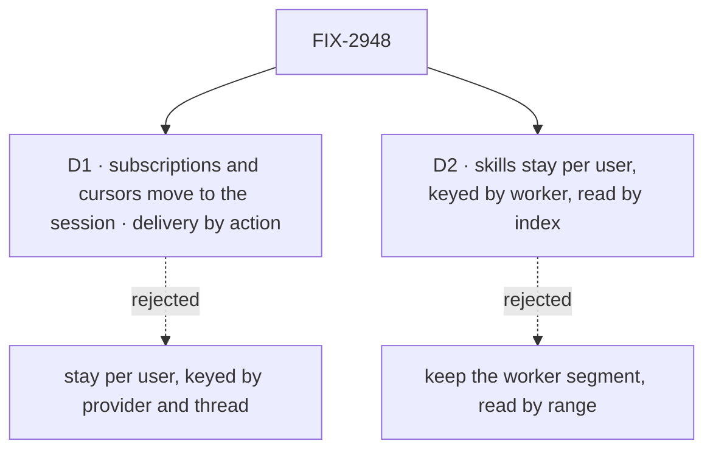

# FIX-2948 · Decisions

[Spec](SPEC.md) · **Decisions**

The epic left each record to be "decided one by one". The spec found two records the other children
don't touch, so it has two calls.

## The tree

Solid edges are what you sign. Dashed edges lost.

## D1 · Subscriptions and their cursors move into the subscribing session's copy; a delivery advances them through the definition's named action

| | |
|---|---|
| **Instead of** | Stay per user, keyed by provider and thread, with the session as a field |
| **Because** | A subscription is one session's interest in a thread: two conversations on one thread are two subscriptions, so a per-user key must name the session, which ER-11 forbids. In the session's copy, the key is provider and thread. A delivery comes from a webhook-started turn, which FIX-2942 refuses any reach into another session. The cursor's advance is already one fixed write, so it becomes the definition's named action, on the session the thread index row names (never one from the payload), with its own check (the delivery's verdict). FIX-2942 admits exactly that as one of its two exceptions |
| **Locks in** | A screen of a user's subscriptions reads across sessions (FIX-2945). The delivery action is the only way a webhook-started turn writes a subscription, and it takes its session from the index row. Existing rows move in FIX-2946's pass, under its placement rule |

It comes down to the key: per user, two conversations on one thread need the session in it.

**What would change my mind:** evidence that no app has two sessions follow one thread. Then the
row is about the thread, per user, and stays.

## D2 · The skills catalog stays per user, keyed by worker and skill, and a worker's catalog is read through a declared `worker` index

| | |
|---|---|
| **Instead of** | Keep the encoded worker segment and read it by FIX-2944's range |
| **Because** | The catalog is about a worker, not a session, so per user is right (ER-11). Reading it by a range over an encoded segment is the encoded prefix rule 12 retires, and keeps the partition wrapper alive. A declared index (FIX-2532) is the store's own way to find rows by a field |
| **Locks in** | Each skill row carries its worker, with an index row beside it. Existing rows keep their keys; FIX-2946's pass writes their index entries. `partitionBy` leaves the skills library's options |

It comes down to the encoded prefix: a range over the segment keeps the partition in all but name.

## Decided, not asked

- **Records already keyed by subject stay**: subscription task endings, polls and the org thread
  index (the index row also names the session, so a delivery can reach the copy), message chains,
  the coding run record, worker usage. Each was read in the code; none is keyed by a session id.
- **One mover.** FIX-2946's pass moves these rows too, so the set has one mover and one follow-up.
- **`endTaskSubscriptions` reads one copy**: the task session's.

## Considered and dropped

| Alternative | Why not |
|---|---|
| Close with a note (the epic's collapse trigger) | Two records are keyed by session-derived values or encoded prefixes |
| Run delivery inside each subscribing session | A turn per subscriber for each event, where today one delivery writes every cursor |

## Analysis

2026-11-26 · watermark 2026-11-25 · **Right approach.** Run over the whole set in the epic agent's
own context.

1. **Reuse:** FIX-2942's reach, FIX-2532's indexes, FIX-2946's mover.
2. **Prior art:** none needed; the inventory is this codebase's.
3. **Other shapes:** closing with a note; ruled out by the inventory.
4. **New factors:** none since the watermark.
5. **Necessity:** the epic's cut candidate; kept, because the inventory found real work.
6. **Ergonomics:** subscriptions read where their conversation is.
7. **Concerns:** the set review found that delivery is a webhook turn and FIX-2942 D1 would refuse
   its plain write. Folded: delivery is a named action.

## How it got here

- **Draft (Nov 26)** in the epic's spec set. The inventory found the subscriptions and the skills
  partition. The set review routed delivery through a named action, after FIX-2942's D1.

**Open: none.**
