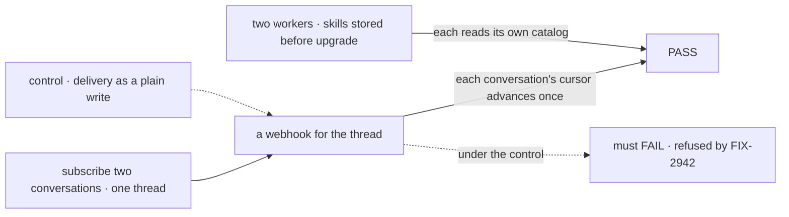
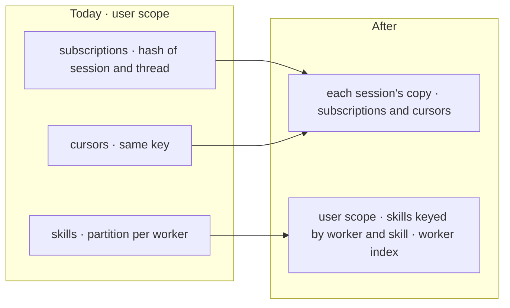

# FIX-2948 · Per-user records keyed by a session value move to session scope or to their subject

**Spec** · [Decisions](DECISIONS.md)

| Someone who… | Today | After |
|---|---|---|
| **subscribes a conversation to a GitHub thread** | The subscription and its cursor sit in the user's pile, under an id hashed from the session, the provider and the thread | They sit in the conversation's own copy. Two conversations on one thread are two copies, not two hashes |
| **cancels a task that had subscriptions** | Every subscription in the user's pile is read, and the task's are picked out | Only the task session's copy is read |
| **gets a webhook delivered to a subscription** | The delivery writes the cursor in the user's pile | The delivery advances the subscription through its named action, which FIX-2942 admits from a webhook turn |
| **runs workers that each keep skills** | Each worker's catalog is a partition, an encoded segment in one per-user collection | Each skill row carries its worker, and a worker's catalog is read through a declared index |
| **upgrades with subscriptions and skills already stored** | n/a | Every row reads the same after the upgrade |

The concept doc counted six per-user collections keyed by a session value. Two are boards
(FIX-2946) and two are the chain and routed-session records (FIX-2947). The code has two more,
listed below, so the collapse trigger in the epic does not fire.

## The goal, and how we'll know it's met

**No per-user record is keyed by a session's id or a value derived from one, no feature builds an
encoded key prefix, and every stored subscription and skill reads the same after the upgrade.**

| Is it the right goal? | |
|---|---|
| **The real need** | Rule 11 of [the concept doc](../../../docs/internal/design/scopes-and-sessions.md#the-rules), the epic's ER-11, and the retired term *partition* |
| **Smaller, and rejected** | "Close with a note: the rest are keyed by subject." The subscriptions are keyed by a hash of the session, and the skills catalog is a partition |
| **Bigger, and not this issue's** | Tenants inside per-user data ([FIX-2065](https://linear.app/fixpoint-labs/issue/FIX-2065)) |
| **Not done if** | A per-user pattern's key is built from a session id · `partitionBy` remains in the skills library · a subscription delivery is refused after the move · a stored row is unreadable |

The check reads each conversation's cursor and each worker's catalog after the delivery.

| How we verify | |
|---|---|
| **Goal check** | `goals/sessions-reach/per-user-by-subject/` · no model · run by the implementer at completion · verdict in the implementation PR |
| **Signal** | A delivery to a thread two conversations follow advances each conversation's cursor once. Cancelling a task ends only its session's subscriptions, reading one copy. Two workers read their own skills only. A store seeded by today's `main` reads every subscription, cursor and skill the same after the upgrade. A sweep finds no per-user pattern keyed by a session id |
| **Input** | GitHub-shaped events from the subscriptions stub. Another provider must pass too |
| **Anti-game** | Read the cursors and catalogs back through their owners' sessions and workers, not the mover's report |
| **Control that must fail** | `GOAL_CONTROL=plain-delivery` must FAIL *each cursor advances once*. Today's `main` fails *no per-user key from a session id* |

## What changes

Data about one session moves into that session. Data about a worker stays per user, keyed by what
it is about.

| Record | Today's key | Decision |
|---|---|---|
| Subscriptions, `workforce/subscriptions/*` | `sub_` + a hash of session, provider, thread, tenant | **Session copy** ([D1](DECISIONS.md#d1)), keyed by provider and thread |
| Subscription cursors, `workforce/subscription-cursors/*` | The subscription's id | **Session copy**, with its subscription |
| Skills catalog (`createSkillsLibrary({ partitionBy })`) | An encoded worker segment | **Per user, by worker and skill**, read through a declared index ([D2](DECISIONS.md#d2)) |
| Subscription task endings, polls, the org thread index | Task id; thread; thread | **Already by subject.** The index row also names the session |
| Message chains, the coding run record, worker usage | Chain id; run; day and worker | **Already by subject.** Unchanged |

**Docs:** the subscriptions guide says a subscription belongs to its conversation; the skills
guide drops `partitionBy`. Both in this PR's changeset. The glossary's *partition* entry is
retired by FIX-2946; this PR adds the skills library to its sweep.

## What stays as it is

- **The org-scope thread index** that nominates subscriptions; it grants nothing.
- **The subscriptions' screens and interest chain**, and their verdicts.
- **The coding run record**, already per user and keyed by its subject.

## What's already here, and the debt

| Already here | What this does with it |
|---|---|
| Subscriptions and cursors (`workforce/src/subscriptions/rows.ts`, `subscriptionIdOf` in `subscribe.ts`) | **Moves** to session scope; the hashed id goes |
| `endTaskSubscriptions`, which lists every subscription in the user's cell and filters by task | **Simplified** to the task session's copy (BP-033) |
| The skills partition (`orchestration/src/skills/partition.ts`), used by `agent-worker-flow.ts` per worker | **Removes**; a declared field index replaces it ([D2](DECISIONS.md#d2)) |
| Declared field indexes ([FIX-2532](https://linear.app/fixpoint-labs/issue/FIX-2532)) | **Builds on** |
| FIX-2942's reach and its webhook rule ([D1](../FIX-2942/DECISIONS.md#d1)) | **Builds on.** Delivery reaches the session's copy through a named action |
| FIX-2946's one-time mover ([D2](../FIX-2946/DECISIONS.md#d2)) | **Builds on.** The same pass moves subscriptions and cursors, and writes the skills index entries |

| Adds | Existing piece considered | How composed |
|---|---|---|
| A delivery action on the subscriptions definition | A plain write from the delivery | The write the delivery makes today, named, so a webhook turn may make it (FIX-2942 D1) |
| A `worker` index on skill rows | The partition; FIX-2944's range read over the encoded segment | A declared index ([FIX-2532](https://linear.app/fixpoint-labs/issue/FIX-2532)); the range read would keep the encoded prefix |

| The debt | |
|---|---|
| **Removes** | `skills/partition.ts`, the hashed subscription id, the list-then-discard in `endTaskSubscriptions` |
| **Adds** | Moves in FIX-2946's mover, gone under the same follow-up ([FIX-2950](https://linear.app/fixpoint-labs/issue/FIX-2950)) |
| **Leaves** | Tenants in per-user data (FIX-2065) |

**Net: down.**

## Sign off

**[The goal](#the-goal-and-how-well-know-its-met), at that size:** every remaining record decided,
two moved. If wrong: a session-keyed pile survives, or a moved row is lost.

**[The debt](#whats-already-here-and-the-debt), net down.** If wrong: the delivery action is a
second way to write a subscription.

1. **[D1](DECISIONS.md#d1) · Subscriptions and cursors move into the subscribing session's copy;
   a delivery advances them through a named action.** If wrong: delivery is refused, or a thread's
   subscriptions are hard to list per user.
2. **[D2](DECISIONS.md#d2) · The skills catalog stays per user, keyed by worker, read through a
   declared index.** If wrong: an index row per skill, for a catalog that was a prefix read.

**Open: none.** D1 is the one to weigh.

Improvement · `workforce` + `orchestration` · medium · epic FIX-2941
