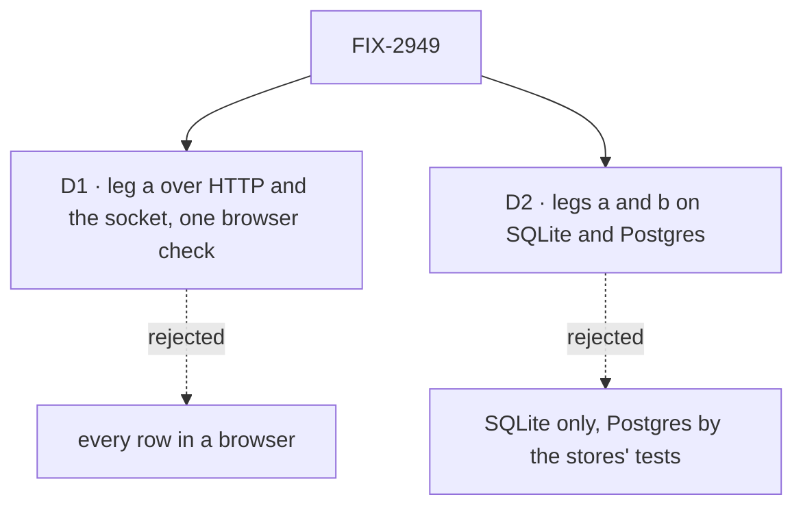

# FIX-2949 · Decisions

[Spec](SPEC.md) · **Decisions**

The closure's shape is [`orchestration.md`'s](../../../docs/contributing/orchestration.md#the-closure-issue-every-epic-ends-in-qa).
Two calls are this plan's own: where leg a looks, and which stores the legs run on.

## The tree

Solid edges are what you sign. Dashed edges lost.

## D1 · Leg a asserts on Shift Manager's view answers over HTTP and the notices on its socket, plus one browser check of the board; findings are bugs under the epic

| | |
|---|---|
| **Instead of** | Every leg a row in a real browser |
| **Because** | What the epic changes reaches the screen through the view's answer and its notice. Those are what a person's board is built from, and they can be asserted exactly and on every run. One browser check confirms the board renders the late sub-task. A browser on every row costs minutes a run and flakes on timing the epic didn't change |
| **Locks in** | A board that renders a correct answer wrongly is caught only by the one browser check. A finding is filed as a bug under the epic, blocking this issue, and is never fixed inside the closure PR |

It comes down to what changed: the answer and the notice, which HTTP reads exactly.

## D2 · Legs a and b run on SQLite and Postgres; the filesystem store's parity is the store conformance suite's

| | |
|---|---|
| **Instead of** | Run the legs on SQLite only, and trust the stores' own tests for Postgres |
| **Because** | FIX-2944 reads Postgres's key ranges in byte order through a new index, and FIX-2945's join is one query per store: a difference between the stores is exactly what the *runs on Postgres or SQLite* team would hit, and a store's own tests don't run a real flow. The filesystem store is development only, and FIX-2945's conformance suite holds it to the SQL stores' answers |
| **Locks in** | A closure run needs a Postgres, so it runs where the integration suite does. Each leg's verdict names its store |

It comes down to a store difference: the collation and the join differ by store.

## Decided, not asked

- **One commit.** Every check runs against the commit after the last child merges; the report
  names it. A check made stale by another epic's merge is updated and re-graded in the same run.
- **Controls are load-time module patches** (`goals/lib/`), never written to the checkout.
- **Leg b's owners are made through the real sign-in path**, never by writing session records,
  so the owner rule meets what a host would really store.
- **The sweep's names come from the gaps file's retired-terms table**, so a term retired later is
  swept too.

## Analysis

2026-11-26 · watermark 2026-11-25 · **Right approach.** Run over the whole set in the epic agent's
own context.

1. **Reuse:** FIX-2883's closure shape and `goals/lib/`.
2. **Prior art:** a release QA pass on one build.
3. **Other shapes:** a browser-only leg a; D1.
4. **New factors:** none since the watermark.
5. **Necessity:** required for every epic.
6. **Ergonomics:** one command, `GOAL_LEG` to pick a leg.
7. **Concerns:** leg a on a real model flakes; 2 of 3 runs is the threshold, as the children use.

## Notes from review

- "FIX-2949's leg c asserts the retired names and `LEFT(`/`substr(` prefix reads are 'absent from `packages/*/src`'. After FIX-2944, the explanatory comments in the four store files will likely still mention `LEFT(...)`/`substr(...)`, and `engine/src/stores/testing/resource-store-conformance.ts` lives under `src` too. The sweep needs to say it matches SQL string literals in store query code, not comments or test helpers." Suggested: "c: no `LEFT(`/`substr(` prefix predicate in a SQL string literal under `packages/store-*/src` (comments and `engine/src/stores/testing` excluded); retired names absent from `packages/*/src`" — Gitar bot, round 1
- "**FIX-2949** re-runs all seven child goal checks plus a gap sweep on one commit, with a real model, on two stores, plus a browser check. The re-run of child goals duplicates CI if those goals run there. Keep legs a/b/c (the cross-child proof); fold the re-run into "CI green on that commit" unless the goals are not in CI." — jhoffner, set review round 1

These are inputs, not instructions.

## How it got here

- **Draft (Nov 26)** in the epic's spec set, from the epic's goal check.

**Open: none.**
