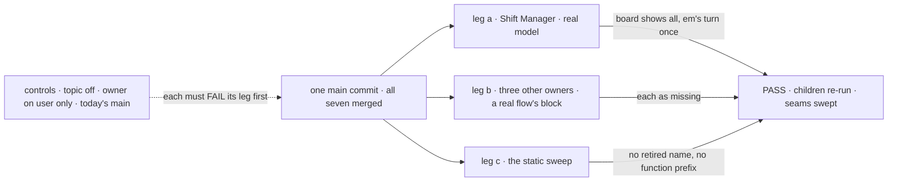
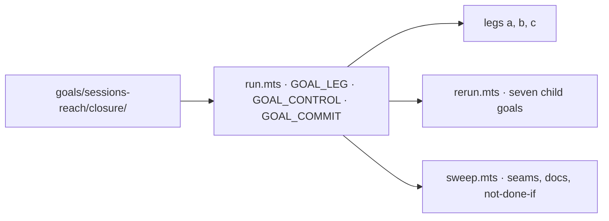

# FIX-2949 · Closure: sessions reach each other within one owner, and nothing else does

**Spec** · [Decisions](DECISIONS.md)

| Someone who… | Today | After |
|---|---|---|
| **signs off epic FIX-2941 at wrap** | Would read seven goal verdicts, each on its own child's commit | Reads one verdict per leg on one `main` commit, each control seen failing first, every child's goal re-run beside it |
| **uses Shift Manager with em and coder** | Is leg a's person: em files, coder settles from its own session, the board shows it all | Gets proof, on a real model, that em's turn starts once and a sub-task filed in a later session appears |
| **hosts more than one org or tenant** | Is leg b's person | Gets proof that another user, the same user in another org and under another tenant each read as missing, for a read, a write and the read across sessions, and that no session or task id reaches another org's socket |
| **runs on Postgres or SQLite** | Is leg c's and the store journey's person | Gets proof that no prefix read uses `LEFT` or `substr`, and that legs a and b pass on both stores |
| **owns a child issue** | Finds a gap between children after the wrap, if anyone does | Gets a bug filed under the epic, naming the leg, the control and the commit; the epic doesn't wrap until it is fixed |

The closure builds no feature. It is the epic's goal check, written before the children build,
and run once they have all merged.

## The goal, and how we'll know it's met

**On one `main` commit after every child merges, within one owner any block reaches any session's
copy by naming it, a screen sees across sessions through one view and one query, the workarounds
are gone, and every other owner reads as missing.**

| Is it the right goal? | |
|---|---|
| **The real need** | The epic's goal and its three legs ([FIX-2941](../../epics/FIX-2941/SPEC.md#the-goal-and-how-well-know-its-met)), plus a journey per team the legs don't walk, every child's goal re-run, and a sweep of the seams |
| **Smaller, and rejected** | "Every child's goal passes." Each proves its piece alone; the board's move (FIX-2946) and the routed task (FIX-2947) only meet on one commit |
| **Bigger, and not this issue's** | Fixing what it finds: each finding is a bug under the epic ([D1](DECISIONS.md#d1)) |
| **Not done if** | A leg ran on a commit other than the one the children merged to · a control was never seen to FAIL · a leg passed on today's `main` · leg a asserted on a child's return value · a child's goal was not re-run · the sweep printed a hit · a finding is open |

Every leg asserts on what Shift Manager shows, on HTTP answers and on socket notices. Each control
must fail before a PASS counts.

| How we verify | |
|---|---|
| **Goal check** | `goals/sessions-reach/closure/` · `GOAL_LEG=a\|b\|c`, all by default · leg a: Shift Manager over HTTP and its socket, a real model for em, plus one browser check of the board ([D1](DECISIONS.md#d1)) · legs a and b on SQLite and Postgres ([D2](DECISIONS.md#d2)) · run by the closure worker on the commit after the last child merges · verdict in the closure PR |
| **Signal** | **a:** em files a task in one conversation; coder settles it from its own session; em's next turn starts once; the board shows the task, and a sub-task filed in a session made after the board opened, within 2 s; 2 of 3 runs. **b:** another user, the same user in another org and under another tenant each name the conversation for a read, a write and the read across sessions, and each is answered as an unknown id is; two schedules on the gateway principal can't name each other's sessions; a client of the same user in another org receives no session or task id on its socket. **c:** the retired names (lineage, `sharedToLineage`, partition, `partitionBy`, filing session, board above, routed session, task chain, carrier) and `LEFT(`/`substr(` prefix reads are absent from `packages/*/src` |
| **Input** | The concept doc's CSV export story; a second task wording must pass too. Leg b's owners are seeded through the real sign-in path, not by writing records |
| **Anti-game** | Never a child's return value, the admission function, or a stubbed board. Leg b runs through a real flow's block |
| **Control that must fail** | `GOAL_CONTROL=topic-off` must FAIL leg a's *late sub-task shown*. `GOAL_CONTROL=owner-user-only` must FAIL leg b's *other org as missing*. `GOAL_COMMIT` at today's `main` must FAIL leg c's *no retired name* |

## What else runs on the same commit

1. **Every child's goal check**, re-run: `goals/sessions-reach/` → `name-a-session`,
   `one-definition-per-name`, `indexed-key-segments`, `across-sessions`, `boards-per-session`,
   `work-not-copies`, `per-user-by-subject`. Each with its own control.
2. **One journey per team** the legs don't walk: *learns task boards* reads the task-board guide's
   example as written and runs it; *hands work from one flow to another* runs FIX-2947's routed
   task from two conversations.
3. **A gap sweep**: each coordination seam in the [epic's decisions](../../epics/FIX-2941/DECISIONS.md#coordination-seams)
   exercised from both sides (eight seams, one check each), the docs each changeset names followed
   as written, and every *not done if* state checked absent.

## What changes

All under `goals/`. No package, app or lab file changes ([D1](DECISIONS.md#d1)).

**Docs:** no documentation impact; the closure is a goal check. The sweep checks that each child's
changeset carries its part of the epic's docs line.

## What stays as it is

- **Every child's own goal check**, which the closure re-runs and doesn't replace.
- **Shift Manager and the kit views**, which the closure drives and doesn't change.

## What's already here, and the debt

| Already here | What this does with it |
|---|---|
| The epic's goal check and its legs ([FIX-2941](../../epics/FIX-2941/SPEC.md#the-goal-and-how-well-know-its-met)) | **Builds on.** Each leg is written down here |
| `goals/lib/` (drivers, the module-patch controls, fixtures) | **Builds on.** Controls are load-time module patches, never written to the checkout |
| The closure shape of [FIX-2883](../FIX-2883/SPEC.md) | **Builds on**: legs, re-runs, sweep, findings as bugs |

| Adds | Existing piece considered | How composed |
|---|---|---|
| The closure goal under `goals/sessions-reach/closure/` | The children's goals | Re-runs them; adds only what crosses children |

| The debt | |
|---|---|
| **Removes** | Nothing |
| **Adds** | One goal check, kept in the repo so it keeps running after the wrap |
| **Leaves** | Tenants inside per-user data (out of the epic) |

**Net: flat.**

## Sign off

**[The goal](#the-goal-and-how-well-know-its-met), at that size:** the epic's three legs on one
commit, with every child re-run and the seams swept. If wrong: the epic wraps with a gap between
two children.

**[The debt](#whats-already-here-and-the-debt), flat.** If wrong: a goal nobody runs again.

1. **[D1](DECISIONS.md#d1) · Leg a asserts over HTTP and the socket, plus one browser check;
   findings are bugs under the epic, never fixed in the closure PR.** If wrong: a board that
   renders wrong passes, or a fix slips in unreviewed.
2. **[D2](DECISIONS.md#d2) · Legs a and b run on SQLite and Postgres; the filesystem store is
   held by the conformance suite.** If wrong: a store difference ships, or the run doubles in
   cost.

**Open: none.**

Improvement · `goals/` · medium · epic FIX-2941 · closure
