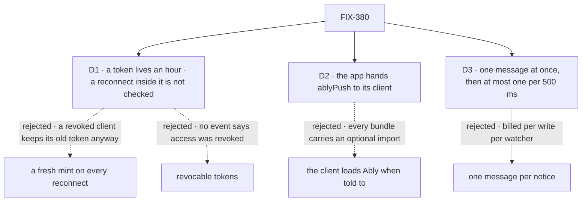

# FIX-380 · Decisions

[Spec](SPEC.md) · **Decisions**

Three calls shape this adapter. D1 is the one to weigh. The epic's D2, D3 and D5, its rules
ER-4, ER-6 and ER-7, and the contracts FIX-2426 and FIX-2428 fix are kept, not reopened.

## The tree

Solid edges are what you are signing. Dashed edges lost, and the label says why.

## D1 · An Ably token lives at most an hour; a reconnect inside that hour is not checked again

| | |
|---|---|
| **Instead of** | The client asking the mint for a fresh token on every Ably reconnect · Ably's revocable tokens |
| **Because** | Ably, not our server, takes the reconnect, and a client holding a valid token can reconnect with it whatever our code asks. So a re-mint in the browser binds only honest clients; the token's life is the one bound the server enforces. An hour is FIX-2428 D2's cap on an open socket, so revoked access stops notices within the same hour on every host. A notice carries no rows (epic D2): what a revoked user keeps is the moment of a change, and every read is still checked. Revocable tokens need the app to call revoke when access changes, and the framework has no such event |
| **Locks in** | Tokens of one hour or less, renewed through the mint, which checks every topic again (Ably's `authCallback` calls it before expiry). ER-4's "every connect and reconnect" holds on Ably as "at least once an hour", stated in the realtime guide |

It comes down to who sees the reconnect: Ably does, so a re-mint in the browser secures nothing.

**What would change my mind:** the framework gaining an event for revoked access. Then revoke the
user's tokens through Ably on it, and the hour stops mattering.

## D2 · The browser half of Ably ships in the Ably package; the app hands it to its client

| | |
|---|---|
| **Instead of** | `@flow-state-dev/client` loading the Ably SDK itself, by an optional import, when `GET /capabilities` reports Ably |
| **Because** | The client depends only on our own `contracts` and `core` today. An optional import is one every app's bundler has to resolve, used or not. With a slot, an app without Ably carries none of it, and a later managed service is another package on the same slot with no client change |
| **Locks in** | `push` on `CreateClientOptions` and the `@flow-state-dev/ably/client` entry, public names. A client told "Ably" with no connector reads on its timer (FIX-2428 D3) and warns once |

It comes down to every app's bundle: an optional import is one every bundler must resolve.

**What would change my mind:** bundlers resolving optional imports the same way, and the client
shipping more than one vendor anyway.

## D3 · A topic sends one Ably message at once, then at most one per 500 ms

| | |
|---|---|
| **Instead of** | One Ably message per notice |
| **Because** | `persistItems` publishes on every streaming update ([FIX-2426](../FIX-2426/DECISIONS.md#decided-not-asked)), many times a second, and Ably bills each message once on publish and once per attached connection. Ably also caps a channel at 50 messages a second. The session stream reads at most once a second anyway, and a hook's reads are coalesced, so the extra notices buy no fresher screen. A notice says only "read again", so folding loses nothing (ER-6) |
| **Locks in** | The first notice on a topic goes at once; later ones in the window fold into one at its end. That last message can be pending when the response ends, so it is handed to `onBackgroundWork`, which serverless apps already set (`after()` on Next). Without it, a function frozen early can drop the last change, and the realtime guide says so |

It comes down to the bill during a streaming reply: one message per write, times every watcher.

**What would change my mind:** Ably no longer billing per message, or a consumer that needs every
notice rather than "read again".

## Decided, not asked

- **One package, `@flow-state-dev/ably`, on the `ably` SDK (v2).** `.` exports `createAbly({ key })`,
  one object that is a `bus` adapter (`capabilities: ["bus"]`) and a delivery for
  `createFlowState({ push })`; `./client` exports `ablyPush()`. Epic D5's two places to
  configure, one object.
- **Delivery is set on `createFlowState`, not on a handler.** Ably's mint needs no socket, so
  `createNextHandler`, the Vercel handler, Lambda and `serve()` all get it, as with
  `onBackgroundWork`. An explicit `push` replaces `serve()`'s WebSocket. `GET /capabilities`
  answers `{ userStream: false, push: { transport: "ably" } }`.
- **The convergence point stays the mint** (FIX-2428). Every channel in a token is one the mint
  granted, on the first connect, on an added topic, and on renewal. The delivery only signs what
  the check granted; it never decides access.
- **The mint signs locally.** Ably's token request is signed with the key on the server, no call
  to Ably per mint; the key never leaves the server.
- **Subscribe only.** The token's capability is `["subscribe"]` on exactly the granted channels:
  no publish, presence or history (ER-7, ER-6). Clients use no rewind.
- **Opaque channel names.** A channel is named by a keyed hash of FIX-2426's bus topic, so it
  names no tenant, user or org id and can't be guessed. The mint returns each wire topic's
  channel. The message carries `kind` and `origin` only, never the bus topic.
- **A narrowed notice publishes on its resource's channel and its scope's**, so both hear it, by
  FIX-2426's hearing rule. Two messages, before D3's fold.
- **Publishes go over REST**, so a write needs no open connection. A failed publish is logged
  and never fails the write (ER-6).
- **The bus's `subscribe` opens one Ably realtime connection per process**, on the first
  subscriber, closed with the last. `crossesProcesses` is true while it is connected, and each
  change goes out through `onCrossingChange`, so a dropped connection brings back the session
  stream's timed read (FIX-2426 D1). On serverless that is one connection per open session-stream
  function.
- **The browser holds one Ably connection per client.** An added topic re-mints and widens the
  token in place (Ably's `authorize`); a refused topic is retried at the poll pace (FIX-2428).
- **`mechanisms.yaml`** adds `ably` to the bus row's and `push-delivery`'s `adapters`.
- **Changesets (minor):** the new `ably` package; `engine` (`push`, the delivery seam); `client`
  (`push`).

## Considered and dropped

| Alternative | Why not |
|---|---|
| Ably AI Transport, items and steering over Ably (the spike) | Epic D2 and ER-7: notices only, items stay on SSE |
| The client SDK as a peer of `@flow-state-dev/client` | D2: every app would resolve it |
| Readable channel names (`fsd:org:<tenant>:<id>`) | Puts tenant and org ids in every browser |
| A token per topic | Ably allows one token per connection; one connection per topic hits the 200-channel limit sooner and multiplies connections |
| `push` on each host handler | Three handlers to change, and the router is built inside `createFlowState` |
| A Redis or Postgres bus with Ably delivery only | Allowed by epic D5's two seams, and not this issue's: Ably fills both here |

## Settled

No POC was built. The design rests on Ably's documented behaviour, read from its docs on
2026-11-01: a token request "signed locally" by the server, which the client exchanges with Ably;
capabilities per channel and operation, updated in place by `authorize()`; access tokens up to
24 hours, revocable ones up to one hour, revocation enabled per key; 200 channels per
connection and 50 messages a second per channel on every package. The goal check runs against
real Ably, so a wrong premise fails there. The spec rests on no counted facts of this
repository, so it ships no checker.

## Analysis

2026-11-01 · watermark 2026-11-01 (FIX-2426 and FIX-2428 specs on `main`) · **Right approach.**
Run by the author, in this dispatch, with no fresh sub-agent: this worker could not dispatch one.
The coordinator may run a fresh `analysis` before the gate.

1. **Reuse** — an adapter of two seams the epic's children define; every Adds row extends the
   mint, the slot map or `CreateClientOptions` ([Builds on / Adds](SPEC.md#whats-already-here-and-the-debt)).
2. **Prior art** — Pusher and Ably both authorize channels through an app endpoint that signs
   a short credential; this is that endpoint, FIX-2428's mint.
3. **Other shapes** — the spike's AI Transport and a client-side optional import; both dropped.
4. **New factors** — FIX-2428 merged its mint "shared with FIX-380"; FIX-2426 made
   `crossesProcesses` an event. Both used here.
5. **Necessity** — earns its place: the epic's only push path on serverless (epic D3).
6. **Ergonomics** — one object passed twice on the server, one line on the client; screens
   unchanged.
7. **Concerns** — D1 reads ER-4 for a service the server can't see; surfaced as the one to weigh.

## How it got here

- **Draft** — the re-scoped FIX-380 as an adapter of the bus slot and the mint: Ably REST
  publish, a locally signed subscribe-only token for opaque channels, `ablyPush` behind a client
  slot, a per-topic fold for the bill.

**Open: none.**
