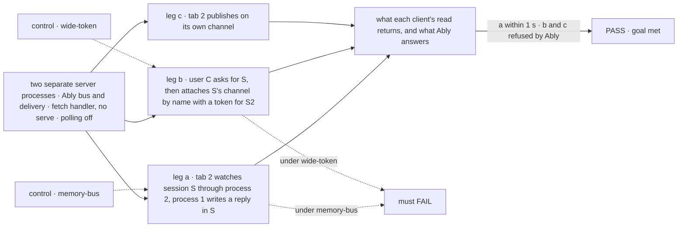
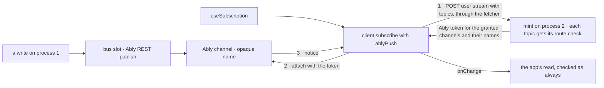

# FIX-380 · Ably adapter: bus and delivery through Ably, so serverless hosts get push

**Spec** · [Decisions](DECISIONS.md)

## Six people, before and after

| Someone who… | Today | After |
|---|---|---|
| **deploys a screen to Vercel or Next** | The hook reads on a timer: a function can't hold a socket open ([epic D3](../../epics/FIX-2367/DECISIONS.md#d3)) | Adds an Ably key and two lines of setup. The same hook hears a change within a second, and reads nothing between changes |
| **runs several serverless instances** | A change on one instance reaches other viewers only at their next poll | Reaches them through Ably, whichever instance wrote it |
| **subscribes to a topic they may not read** | Refused by the mint ([FIX-2428](../FIX-2428/SPEC.md)) | Refused by the same mint, and Ably refuses any channel that is not in their token |
| **loses access while their tab stays open** | The socket ends within an hour | The Ably token ends within an hour: the same bound ([D1](DECISIONS.md#d1)) |
| **pays the Ably bill** | n/a | At most two messages a second per topic during a streaming reply, times its watchers ([D3](DECISIONS.md#d3)) |
| **builds an app without Ably** | n/a | Ships no Ably code: the client package gains a slot, not a dependency ([D2](DECISIONS.md#d2)) |

The epic ([FIX-2367](../../epics/FIX-2367/SPEC.md)) names this the second adapter: Ably fills
both seams, the bus that carries a notice between processes and the delivery that carries it to
a browser. Notices only, no rows ([epic D2](../../epics/FIX-2367/DECISIONS.md#d2)). Item and
request streams stay on SSE (ER-7), so the original spike's "route the event queue through Ably"
is not this issue's.

## The goal, and how we'll know it's met

**On a serverless host, with Ably configured, a screen built on the framework's hook hears a
change made on any other instance within a second; a caller only ever holds an Ably credential
for the topics the mint granted; and an app that doesn't use Ably carries none of it.**

| Is it the right goal? | |
|---|---|
| **The real need** | The epic's row for Vercel and Next: "With the Ably adapter, gets push", and its D5 test that two seams are the right two |
| **Smaller, and rejected** | An Ably bus alone. It crosses instances, but a browser on Vercel still has no wire to hear it on, so screens keep polling |
| **Bigger, and not this issue's** | The spike's list: items over Ably, presence, barge-in, mobile push, LiveObjects. Push on serverless without a managed service (epic D3) |
| **Not done if** | A token minted for one topic lets a client attach to another · a client can publish to a channel · the API key, or a tenant, user or org id, reaches the browser · the last change of a burst is never heard because the function ended first · a screen on an Ably host reads on its timer while connected · the realtime guide still says Vercel only polls |



The check reads what the client's read returns and what Ably answers to an attach, not whether
`publish` was called.

| How we verify | |
|---|---|
| **Goal check** | `goals/realtime/ably/`, model `n/a` (a handler action writes the reply). Run by the implementer at completion; the verdict goes on the implementation PR. Needs FIX-2426 and FIX-2428 merged |
| **Signal** | Leg a: tab 2's read shows the reply within 1 s, and tab 2 makes no read between changes over 10 s. Leg b: the mint refuses S, and Ably refuses the attach to S's channel. Leg c: Ably refuses the publish. A burst of 20 writes ends with tab 2's read showing the last one |
| **Input** | Two Node child processes, each a `createFlowState` behind `createNextHandler`'s fetch handler, over one Postgres, each with its own Ably connection. A throwaway Ably app (Ably's sandbox, as `ably-js`'s own tests use, or `ABLY_API_KEY`) |
| **Anti-game** | Real Ably, not a mocked SDK; two processes, not two registries in one. Assert on read results and Ably's refusals, not on frames sent |
| **Control that must fail** | `GOAL_CONTROL=memory-bus` (each process on the in-memory bus): leg a's 1 s signal must FAIL. `GOAL_CONTROL=wide-token` (the token grants every channel): leg b's attach refusal must FAIL. Today's `main`: all legs FAIL |

## What changes


One package, two options, and the hook a screen already uses keeps working unchanged.

```diff
 // server: the same object fills both seams (epic D5: two places to configure)
+import { createAbly } from "@flow-state-dev/ably";
+const ably = createAbly({ key: process.env.ABLY_API_KEY! });
 export const flowstate = createFlowState({
   flows,
-  stores: { default: { primary: postgres } },
+  stores: { default: { primary: postgres, bus: ably } },
+  push: ably,
   onBackgroundWork: (p) => after(() => p), // already set on Vercel; now also keeps D3's last message alive
 });

 // browser
+import { ablyPush } from "@flow-state-dev/ably/client";
-const fsd = createClient({ userId, baseUrl: "" });
+const fsd = createClient({ userId, baseUrl: "", push: ablyPush() });

 // a screen: no change (FIX-2428's hook)
 useSubscription([topic.session(sessionId)], refresh, { pollIntervalMs: 3000 });
```

**Docs:** update the realtime guide `apps/docs/guides/realtime.md` (FIX-2428 creates it) with the
Ably row in its host table and a setup section; update `server/host-adapters.md` (push on Vercel
and Next with Ably), `persistence/overview.md` (*Store adapters*: Ably backs `bus`), and
`api/client.md` (the `push` option); create `packages/ably/README.md`. No new reference page.



A channel reaches a browser only through the mint, so Ably never decides access; it enforces
what the mint signed.

## What stays as it is

- **The mint's per-topic check, `client.subscribe`, `useSubscription` and the timer** (FIX-2428).
  Only what the mint signs and what the client connects to change.
- **The bus contract and its publish points** (FIX-2426). Ably is one more adapter of the slot.
- **SSE request and item streams, and the session stream** (ER-7). On an Ably host the session
  stream is woken by the Ably bus, as by any bus that crosses processes.
- **Hosts without Ably**: `serve()` keeps its WebSocket; serverless keeps the timer (epic D3).

## What's already here, and the debt

| Already here | What this does with it |
|---|---|
| **The job, "tell a screen that something changed".** `mechanisms.yaml` gains the bus row (FIX-2426) and `push-delivery` (FIX-2428); this is an adapter of both, not a new way. Searched `ably`, `pusher`, `realtime`, `token` across `packages/`: no prior adapter | **Adapts.** Adds `ably` to both rows' `adapters` |
| The `bus` slot and `ChangeNotice` contract, `crossesProcesses` and `onCrossingChange` ([FIX-2426](../FIX-2426/DECISIONS.md#decided-not-asked)) | **Builds on.** The Ably bus fills the slot; its `crossesProcesses` follows its connection |
| The mint, `POST /users/:userId/stream`, and `push` in `GET /capabilities` ([FIX-2428 D1](../FIX-2428/DECISIONS.md#d1)): "FIX-380 answers the same call with its Ably token" | **Extends.** What the mint signs moves behind a delivery: a ticket for the WebSocket, an Ably token here. The check stays the one convergence point |
| `createFlowState({ onBackgroundWork })`: keeps post-response work alive on serverless | **Builds on** for D3's last message |
| `CreateClientOptions` (`client.ts`): a user and a transport, no vendor code | **Extends** with `push` ([D2](DECISIONS.md#d2)) |
| [Epic D2, D3, D5](../../epics/FIX-2367/DECISIONS.md), [ER-4, ER-6, ER-7](../../epics/FIX-2367/DECISIONS.md#who-owns-what) | **Kept.** ER-4's "every reconnect" holds on Ably as the token's hour ([D1](DECISIONS.md#d1)) |
| The FIX-380 spike (items through Ably AI Transport, presence, barge-in, push) | **Superseded** by the epic's re-scope; none of it carried over |

| Adds | Existing piece considered | Why it doesn't fit, or how this is composed from it |
|---|---|---|
| `@flow-state-dev/ably` (server: `createAbly`) | `store-postgres`'s adapter shape; `bullmq`'s vendor package | Composed: an adapter of the `bus` slot, in its own package as every vendor SDK is |
| A delivery seam behind the mint, set by `createFlowState({ push })` | FIX-2428's ticket signer; `serve({ pushSecret })` | Extends the mint. `createFlowState`, because Ably's mint needs no socket, so every host gets it, like `onBackgroundWork` |
| `@flow-state-dev/ably/client` (`ablyPush`) and `createClient({ push })` | `client.subscribe`'s WebSocket path | A second connector beside it, behind one slot ([D2](DECISIONS.md#d2)) |

| The debt | |
|---|---|
| **Removes** | The poll on serverless, for apps that add Ably. No code goes |
| **Adds** | A package with a vendor SDK, permanent by design (epic D3). Two options: `push` on `createFlowState` and on `createClient`. The fold window ([D3](DECISIONS.md#d3)) |
| **Leaves** | Serverless without Ably polls (epic D3). Ably's limit on channels per connection (200 by default); a screen past it polls the rest |

**Net: up**, by one package and two options; it is the epic's planned second adapter, and its
first test that the two seams are the right two.

## Sign off

**[The goal](#the-goal-and-how-well-know-its-met):** push on serverless through Ably, a
credential only for granted topics, nothing for apps without Ably. If wrong: Vercel apps poll
with an Ably bill.

**[The debt](#whats-already-here-and-the-debt): up**, by a vendor package and two options. If
wrong: a package nobody installs.

1. **[D1](DECISIONS.md#d1) · An Ably token lives an hour; a reconnect inside it is not checked
   again.** If wrong: a revoked user hears that something changed, never what, for up to an hour.
   **The one to weigh**: it reads ER-4 for a service our server can't see.
2. **[D2](DECISIONS.md#d2) · The browser half ships in the Ably package; the app hands it to its
   client.** If wrong: one setup line that nobody needed.
3. **[D3](DECISIONS.md#d3) · A topic sends one Ably message at once, then at most one per
   500 ms.** If wrong: a change heard half a second later for a bill nobody worried about.

**Open: none.**

Feature · new `ably` package, engine, client · medium · epic FIX-2367 · blocked by FIX-2426 and FIX-2428
