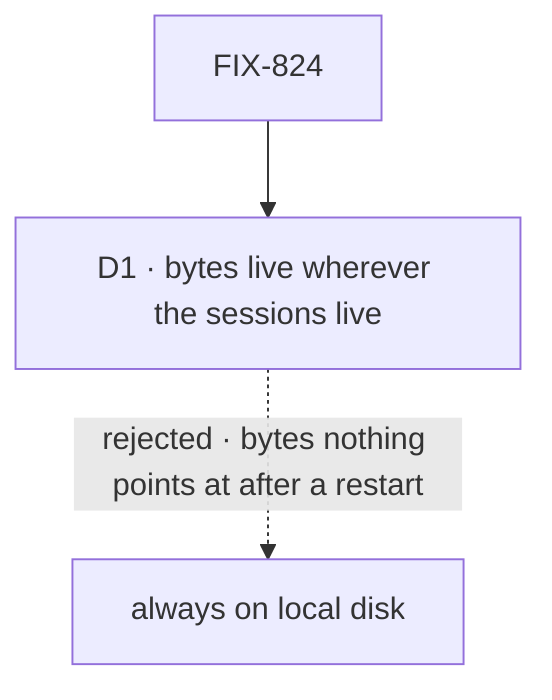

# FIX-824 · Decisions

[Spec](SPEC.md) · **Decisions**

The epic already settled the big calls: bytes go through a blob store with a local-disk default
([epic D2](../../epics/FIX-2516/DECISIONS.md#d2)), the reference rides in `FileContent.data` as
`fsd-blob:<id>` ([epic D4](../../epics/FIX-2516/DECISIONS.md#d4)), and reads always pass the
session check (ER-3). One call is the store's own.

## The tree

Solid edges are what you're signing. Dashed edges lost, and the label says why.

## D1 · Attachment bytes live wherever the sessions live: on disk when they persist, in memory when they don't

| | |
|---|---|
| **Instead of** | Always on local disk, whatever the primary store is |
| **Because** | A file belongs to a session and is deleted with it. On an in-memory profile a restart drops every session, so bytes kept on disk would be owned by nothing |
| **Locks in** | A profile with a durable primary writes attachments to disk by default: under a filesystem primary's `rootDir`, else `.fsdev/blobs` in the server's working directory. An operator who backs up the database alone misses them, and the docs say so. `localBlobStores({ rootDir })` is the public name for choosing another folder |

It comes down to a restart of an in-memory app: always-on-disk leaves files no session can show.

## Decided, not asked

- **The convergence point for bytes is the resolver.** Every model-message build and every
  harness hand-off turns a reference into bytes through it, and nothing else decodes `data` or
  string-matches `fsd-blob:` (ER-1). A test greps for both outside the helper and the resolver.
- **Claiming is part of the send.** An upload is held for its uploader; the action that names it
  claims it into the turn's session, after the session check. A reference held by another user,
  or already claimed by another owner, is refused by name.
- **An owner is a session or a board's scope.** FIX-2522 claims a task's files into its board's
  scope; a read of such a file passes that scope's read check. The store knows owners, not tasks
  (ER-7: no task noun in the store).
- **The store sweeps unclaimed uploads itself**, no sooner than 24 hours, checked when the store
  opens and on each upload, so a quiet server keeps them until its next upload. No scheduler.
- **A session's files go in the session's existing cascade**: `handleDeleteSession`'s `deleteAll`
  step, beside its content and resource state, and `purgeStaleResourceState`
  (`engine/src/context/session-birth.ts`) when a deleted id is reborn. No second delete path.
- **A task's files go by id**: deleting a task deletes the references on its row; the board's
  scope stays their read check, so a sibling task's files stay (FIX-2522).
- **One id per upload, no content addressing.** Dedupe would share bytes across owners, which the
  one-owner rule forbids.
- **Types are an allowlist, not a byte check.** An upload's declared type must be on the
  limits set's list, and text-like files must be UTF-8 with no NUL bytes. No per-type signature
  table: the read route below already stops a mislabelled page from running.
- **The read route** sends `X-Content-Type-Options: nosniff`, serves images inline and every
  other type as a download. Its paths sit beside the flow's session routes.
- **Upload is a raw body**, the transcribe route's shape (`handleTranscribe`), and the client's
  upload mirrors `client.transcribe`. No multipart parser.
- **The resolver's base64 step** is `uint8ArrayToBase64` in `engine/src/streaming/binary.ts`.
- **The limits set** (`@flow-state-dev/contracts/attachments`): 10 images and 5 documents a
  message; 20 MB a file; PNG, JPEG, WebP, GIF and PDF in v1, so the kill line's PDF uploads;
  PDFs to 100 pages, counted server-side before any model call by FIX-2520's extractor (ER-4);
  text-like files to 200 KB of text (FIX-2520 D2); HEIC refused. FIX-2520 adds the text-like
  types in this one file. It also holds the accepts-list type each target fills (FIX-2519,
  FIX-2520).
- **A host whose disk doesn't last** says so in its runtime config (`@flow-state-dev/vercel`'s
  host adapter), not in its store adapter, so the kill line's "no change to the existing store
  adapters" holds. The engine then refuses an upload with a named error; it names no host.
- **The kill line's server is Kitchen Sink's local profile** on SQLite, restarted for real.

## Considered and dropped

| Alternative | Why not |
|---|---|
| Blobs inside `ContentStore` as base64 strings | One read of a session's resources would carry every byte; and a 20 MB file is 27 MB of JSON |
| Blob rows in SQLite or Postgres | Changes the existing adapters, which the kill line forbids, and grows the database by the bytes |
| A signed read URL | A link that outlives the session check (ER-3). Not in v1 |
| Upload addressed to a session up front | A first message in a new chat has no session yet; holding for the uploader covers it |

## Analysis

2026-11-08 · watermark 2026-11-05 (epic merged, #4787) · **Right approach.** Run over the whole
set by `epic-agent`; this issue's lines:

1. **Reuse** — extends the `blobs` slot and the session check; `ContentStore` considered and
   left. See [Builds on / Adds](SPEC.md#whats-already-here-and-the-debt).
2. **Prior art** — OpenAI's and Anthropic's file APIs both take the bytes once and hand back an
   id that later messages carry. Confirms the shape.
3. **Other shapes** — inline bytes under a cap, the epic's rejected Q1.
4. **New factors** — none since the epic merged.
5. **Necessity** — every other child goes through it.
6. **Ergonomics** — an app writes nothing; a profile line only to move the folder.
7. **Concerns** — a backup that misses the bytes. Recorded in the docs line.

## How it got here

- **Drafted (Nov 8)** in the epic's spec set, after the epic's amendment (#4787) put storage
  here and made its goal check the kill line.
- **Set review (Nov 8).** D1 amended the epic's "used whenever a profile names none" to follow
  the sessions; the Vercel mark moved to the host's runtime config; FIX-2522 needed a board's
  scope as an owner, so a claim takes one; FIX-2520 added the 200 KB text cap to the limits set.
- **Fold (Nov 8), the set's first independent read.** PDF joined the v1 type list, so the kill
  line's own upload passes (gitar). D2, the per-type byte signatures, went: nosniff and
  download-only already close what it closed (second look, and the Architect's note). Postgres
  left the goal check for a unit test; the session-copy re-claim went (no session copy exists).
  Reuse: transcribe's raw-body upload, `binary.ts`, and the session delete's cascade.

**Open: none.**
