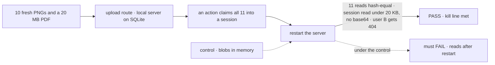
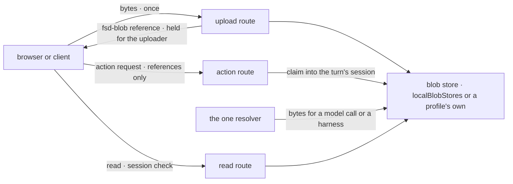

# FIX-824 · Blob storage: attachment bytes kept by reference, local disk by default

**Spec** · [Decisions](DECISIONS.md)

## Five people, before and after

| Someone who… | Today | After |
|---|---|---|
| **attaches a screenshot in any chat** | The bytes have nowhere to go but inside the request, as base64 | The file goes up once and comes back as `fsd-blob:<id>`; every message after carries only that |
| **reloads, or restarts the server** | Nothing to reload | The same file, read back byte for byte, through a route that checks who is asking |
| **runs one server with SQLite or Postgres** | n/a | Files land on that server's disk under `.fsdev/blobs` with no new dependency; the docs say a database backup misses them |
| **runs a test suite on memory stores** | n/a | Files stay in memory and go with the sessions ([D1](DECISIONS.md#d1)) |
| **deploys to a host whose disk doesn't last** | n/a | Attachments are refused by name until the deploy names a hosted adapter |

This is the epic's first child, and its goal check is the epic's kill line
([FIX-2516](../../epics/FIX-2516/SPEC.md#the-goal-and-how-well-know-its-met)). If it can't hold
ten images and a 20 MB PDF through a restart with no new dependency, the app children stop.

## The goal, and how we'll know it's met

**A file sent to a running local server comes back byte for byte after a restart, to the
people who can read its session and to no one else, while every message and session read
carries only a reference to it.**

| Is it the right goal? | |
|---|---|
| **The real need** | Every chat in the epic needs a place for bytes that no host's request or response limit caps ([epic D2](../../epics/FIX-2516/DECISIONS.md#d2)) |
| **Smaller, and rejected** | "Upload and read routes exist." Passes on memory stores, where a restart loses everything the kill line asks for |
| **Bigger, and not this issue's** | Hosted adapters (S3, Vercel Blob); upload-once at the provider ([FIX-891](https://linear.app/fixpoint-labs/issue/FIX-891)) |
| **Not done if** | A file reads back but not after a restart · another user can read it by id · the session read carries base64 · a package gained a required dependency · an existing store adapter changed |



The check reads the bytes the read route returns after a real restart, not the store's own
answer.

| How we verify | |
|---|---|
| **Goal check** | `goals/attachments/survive-a-restart-by-reference/` · model-free · the implementer at completion · verdict in the implementation PR |
| **Signal** | After the restart: all 11 reads return the uploaded bytes (SHA-256 equal); the session read is under 20 KB, holds 11 `fsd-blob:` references and no base64 run over 1 KB; a second user's read of each id is 404. `git diff` on `store-sqlite`, `store-postgres` and the engine's filesystem and memory stores is empty; no `dependencies` entry was added |
| **Input** | Fresh random images and a PDF padded to 20 MB, made per run. A Postgres primary must pass too |
| **Anti-game** | Don't read the files off disk or through the store interface. The route is what a person reaches |
| **Control that must fail** | `GOAL_CONTROL=memory-blobs`: FAIL on *all 11 reads after the restart*. Today's `main`: FAIL at upload (no route) |

## What changes


Read the right column top to bottom: it is one file's life, from upload to the read after a
restart.

**What an app writes, when it writes anything:**

```diff
  stores: {
    default: {
      primary: sqliteStores({ filename }),
+     // optional: the default already writes to .fsdev/blobs when sessions persist
+     blobs: localBlobStores({ rootDir: "/var/lib/myapp/blobs" }),
    },
  },
```

**A client, by hand:**

```diff
+ POST …/blobs            (multipart: one file)   → 201 { attachment: { type: "file", mediaType, filename, data: "fsd-blob:b_8f2…" } }
+ GET  …/blobs/b_8f2…      → the bytes, if you can read the session that owns it; else 404
```

**Docs:** a new *Attachments: where the bytes live* section in the store guide (the default,
the durability rule, a serverless deploy needs a hosted adapter, a database backup misses the
bytes on disk), the `blobs` slot in the store-adapter reference, and the limits set in the
contracts README. FIX-2517 publishes the shared story; this adds its storage half.

## How a file moves



Bytes cross the wire twice, up once and down on a read. Everything between carries the
reference, and only the resolver turns it back into bytes ([ER-1](../../epics/FIX-2516/DECISIONS.md#who-owns-what)).

## What stays as it is

- The action request stays JSON. `ContentStore` keeps holding strings.
- `store-sqlite`, `store-postgres` and the engine's filesystem and memory stores: untouched.
  The Vercel host says its disk doesn't last in its runtime config, not in its store adapter.
- `FileContent` keeps its published shape; only `data` gains the `fsd-blob:` form ([epic D4](../../epics/FIX-2516/DECISIONS.md#d4)).
- No direct read URL and no signed URL in v1 ([ER-3](../../epics/FIX-2516/DECISIONS.md#who-owns-what)).

## What's already here, and the debt

| Already here | What this does with it |
|---|---|
| The reserved `blobs` slot (`engine/src/stores/store-adapter.ts`, `FORWARD_COMPATIBLE_SLOTS` in `resolve-slots.ts`) | **Extends.** It resolves to a blob store; the skip branch goes |
| `createFilesystemStores`'s `rootDir` | **Builds on.** A filesystem primary puts blobs under its own root |
| The in-memory detection FIX-2452 D1 prints at startup | **Builds on.** It decides [D1](DECISIONS.md#d1) |
| `loadCheckedSession` (`engine/src/routes/route-utils.ts`), the session read's check | **Builds on.** Every read and claim passes it |
| `FileContent` (`contracts/src/items/content.ts`) | **Builds on**, in reference form |
| `ContentStore` | **Leaves alone.** It holds strings per resource. Searched `blob`, `binary`, `upload`, `Buffer` across `packages/*/src`: nothing else stores bytes |
| [FIX-2452 D2](../FIX-2452/DECISIONS.md#d2): `blobs` stays reserved until this lands | **Kept, then fulfilled.** The docs' "reserved" line goes |

| Adds | Existing piece considered | Why it doesn't fit / how composed |
|---|---|---|
| `BlobStore` and `localBlobStores` | `ContentStore`; the `blobs` slot | Fills the slot in the store-adapter shape; `ContentStore` is strings keyed by resource |
| Upload and read routes | The action route | The action route stays JSON. Both reuse `loadCheckedSession` |
| `contracts/attachments`: the limits set, the `fsd-blob:` helper | `PromptInput`'s limit props | One set both sides read ([ER-4](../../epics/FIX-2516/DECISIONS.md#who-owns-what)); the props default to it |
| The one engine resolver | None. Searched `data:` and base64 decoders in `engine/src` | New: the only place a reference becomes bytes |

| The debt | |
|---|---|
| **Removes** | The `blobs` skip branch in `resolve-slots.ts`; the "reserved" docs line |
| **Adds** | A store kind, two routes, a sweep inside the store. A durable profile's bytes sit on disk beside a database, so a backup has two halves; permanent until a hosted adapter, which is not filed |
| **Leaves** | No hosted adapter: a serverless deploy refuses attachments by name ([epic debt](../../epics/FIX-2516/SPEC.md#whats-already-here-and-the-debt)) |

**Net: up, on purpose.** One store kind and two routes, the epic's accepted debt.

## Sign off

**[The goal](#the-goal-and-how-well-know-its-met), at that size:** byte for byte after a
restart, scoped to the session's readers, references everywhere else. If wrong: the app
children build on a store that loses files or leaks them.

**[The debt](#whats-already-here-and-the-debt), net up:** a store kind and two routes. If wrong:
a backup story operators get wrong.

1. **[D1](DECISIONS.md#d1) · Attachment bytes live wherever the sessions live: on disk when they
   persist, in memory when they don't.** If wrong: an in-memory app loses files it could have
   kept, with no session to show them.
2. **[D2](DECISIONS.md#d2) · An upload's type is what its bytes are, not what the caller says.**
   If wrong: a renamed file is refused that a model would have read.

**Open: none.** D2 is the one to weigh.

Feature · `contracts` + `engine` + `vercel` · medium · epic FIX-2516
