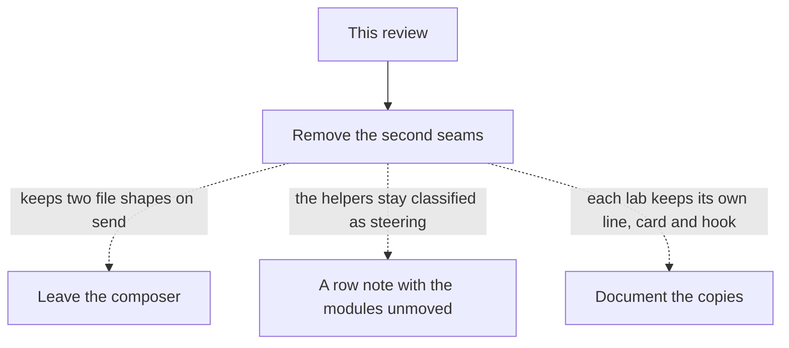

# Weekly review · Decisions

**Spec** · [SPEC.md](SPEC.md) · [The review](assets/weekly-review.md)

## The tree

Solid is what the spec ships. The dashed edges are the alternatives that lost, with why on the label.

## Decided, not asked

- **The composer keeps `attachments: FileContent[]`.** [FIX-2516 D3](../../epics/FIX-2516/DECISIONS.md#d3) already chose references beside the input. `files: FileAttachment[]` is the shape that decision rejected. The goal page is the one caller of `files`, and it sends them inside the action input.
- **The attachment row's file is `packages/contracts/src/attachments.ts`, anchor `toBlobRef`.** That is the helper [FIX-2516 ER-1](../../epics/FIX-2516/DECISIONS.md#who-owns-what) names as the only writer of the scheme. The other option was to point the row at `record-attachments.ts` and leave it in `helpers/`. That would exact-match the core module and leave the scheme helper tied between `item` and `contracts`, and it would keep the module in the directory whose only row is harness steering. Moving the two modules to `packages/core/src/attachments/` is what stops the false match. What would change it: the classifier learning to cover a directory, which this spec does not add.
- **`useDraftSend` lives in `@flow-state-dev/react`.** `useDraft` and `useSubmit` are already there. `@flow-state-dev/ui` depends on React, so the hook cannot move the other way without a cycle. The argument is a structural handle, not the lab's `Attachments` type.
- **The working line does not grow a monospace command.** `WorkingLine` puts the text after "Running " in monospace. Teammates shows the same text in `StreamingIndicator` without that treatment. One indicator, the one already shared. What would change it: a person needing the command set off as code. Then it is one prop on `StreamingIndicator`, still not a second component.
- **The tracker lint is not widened.** [FIX-2453](../FIX-2453/SPEC.md) says tests outside `src` are not linted, and that BP-006 keeps labels out of their titles. This week the titles and the JSDoc broke that assumption. The fix that aligns with the spec is to rewrite them. Widening the rule would amend "what stays", and that amendment is raised on FIX-2453 rather than made here. Issue keys that are the branch namer's input stay.

## Considered and dropped

| Alternative | Why it lost |
|---|---|
| Leave `PromptInputMessage.files` as a convenience alias | It is a second shape, and the goal teaches the send FIX-2516 rejected |
| Delete `WorkingLine` including `WorkingDots` | The thread row uses the dots as its own mark. The duplicate is the in-flight line |
| Keep `orderedLands` in the lab and add a lint that the copy may differ | The install rule is byte-identity. A blessed diff is a second copy with a permit |
| Point the mechanism row at `record-attachments.ts` | See decided, not asked. The scheme helper is the anchor the epic named |
| Extend `fsd/no-tracker-ids` to test files | It amends FIX-2453, which left tests outside `src` unlinted on purpose. Raised, not done here |
| Amend FIX-2623, FIX-2624 or FIX-2516 | None of these findings contradict those specs. The composer change follows FIX-2516. The in-flight work is listed in the review and left alone |

## Open

**Open: none.**

## Analysis

2026-11-11 · watermark `8f4dd8f29` (main at the start of the review) · **Right approach.** The weekly review is the analysis. No separate sub-agent, and no industry pass: the work is removal against decisions this repo already signed.

1. **Reuse** — the Adds rows are a registry name for a mechanism that exists, and a hook composed from `useDraft` and `useSubmit`. Verdicts are in [SPEC.md](SPEC.md#whats-already-here-and-the-debt).
2. **Prior art** — FIX-2516 D3 and ER-1 for the file shape. FIX-2453 / #4907 for the tracker check. The registry-copy rule in `apps/kitchen-sink/CLAUDE.md`.
3. **Other shapes** — in the tree and in considered and dropped. None survived.
4. **New factors** — views, kits and `client.live` landed the same week and already own the read path. Counted, not folded in.
5. **Necessity** — each row removes a second seam or makes a check able to fire. A report with no code change was the smaller goal and lost.
6. **Ergonomics** — send sites pass `attachments` as they do now. The hook's call shape matches the two labs.
7. **Concerns** — a registry refresh deleting `orderedLands` before the move lands. The review card item and the refresh are one change.

## How it got here

- **Draft (11 Nov 2026)** — from the weekly review of PRs opened on or after 4 Nov 2026. Linear had no API key and no Linear MCP, so no issue was filed and this directory uses a placeholder id.
