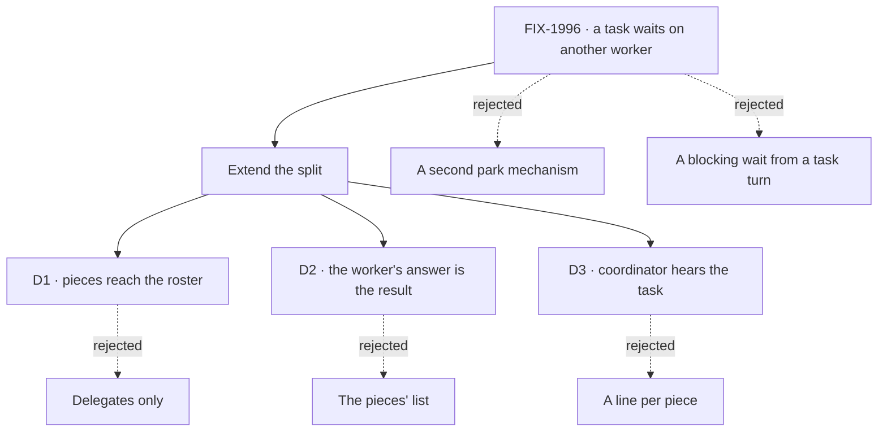

# Park on a task · Decisions

[Spec](SPEC.md)

The direction is settled first (extend the split); the three calls below are what the merge signs.

## D1 · Can a worker on a task hand a piece to any worker, or only its delegates?

- **Plain terms.** Today a worker splitting its task can only hand pieces to the workers it delegates to. The ask is for a task to get a result from whoever has it.
- **Trade-off.** Any task-taking worker on the user's roster matches who `messageWorker` already reaches (FIX-1989), and is what makes the goal reachable. The price is that a worker can now put work on a teammate it doesn't manage, so a busy worker can get pieces it didn't expect.
- **Recommendation: any task-taking worker on the roster.** The chain limits (FIX-1802 S5) already bound how deep and wide this goes.
- **What would change my mind.** Workers getting pieces they shouldn't. Then reach becomes opt-in per worker (a "takes pieces from teammates" flag), with nothing persisted changing shape.
- **If wrong.** A narrowing later is one roster rule; no data migrates.
- **Delegates stay, as the reporting line** (Jake, 2026-10-14). A worker's delegates are who it hands its own work to by default and owns the results of. Collaboration, a message or a piece, is open to anyone on the roster.

It comes down to a fact another worker holds: with delegates only, the task parks on a person for it.

## D2 · Whose answer does the filer get back from a split task?

- **Plain terms.** Today a split task completes with a list of its pieces' outputs. The worker reads them in the turn each ending wakes, but what it concludes there is dropped.
- **Trade-off.** The worker's answer is what a filer asked for ("find out and tell me"), and it is what makes the goal's report possible. The price: a split task's output changes shape for anyone reading the pieces' list today. The list stays, under the answer.
- **Recommendation: the worker's answer from the turn the last piece's ending woke, with the pieces listed under it**, and the pieces' list alone when no turn answered (a replay after a crash).
- **What would change my mind.** A filer that depends on the bare list. None does on `main` today (checked by the implementer before the change).
- **If wrong.** Reverting is one branch in the settle.

It comes down to what the filer asked for: a conclusion, not raw outputs.

## D3 · Does the coordinator hear a piece's ending?

- **Plain terms.** A piece's ending wakes the worker that filed it. The coordinator hears only when the whole task ends.
- **Trade-off.** One owner per ending keeps the coordinator's conversation about the work it handed out, not every step under it. The price: the coordinator doesn't see a piece land until the task does.
- **Recommendation: no, as the split does today.**
- **Change from the first draft.** That draft leaned toward the coordinator getting a line for each ending (its D4), and the product lead reported that lean as Jake's call. It belonged to a mechanism this draft drops. Merging this spec settles it the other way, so it is named here rather than changed silently.
- **If wrong.** Adding a line is one act in the notice handler.

It comes down to one owner per ending: the worker that filed the piece.

## The first draft's decisions, under the split

| First draft | Under the split |
|---|---|
| **D0** no timer on a parked parent | Holds: the split's park has none |
| **D1** cancelling a parked parent cancels the child | Holds: `cascadeIfSplit` cancels open pieces |
| **D2** one child per park | Superseded: the split waits on every piece and wakes a turn for each ending, so one-at-a-time is the worker's choice, not a limit |
| **D3** `deps` stays same-board | Holds, unchanged |
| **D4** the coordinator hears a line | Changed: see [D3](#d3) above |
| **D5** a child's question unparks the parent | Holds: a piece's question wakes the turn of the worker that filed it, which answers it |
