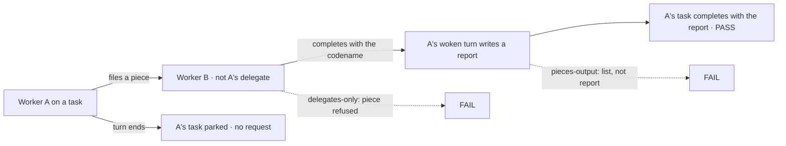
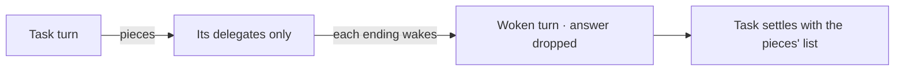
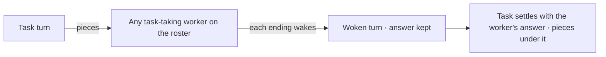

# Park on a task: a worker on a task waits for another worker's task without blocking

**Spec** · [Decisions](DECISIONS.md) · epic FIX-1996 (Workforce: Shift Manager)

## The premise, corrected

The first draft said a task turn can't wait on another task. In Workforce it already can, by **splitting**: a worker on a task files pieces with `dispatchTask`, its turn ends, its task parks quietly, each piece's ending wakes a **new turn** in that task's session with the piece's notice, and when no piece is open the task settles ([`split.ts`](https://github.com/fixpoint-labs/flow-state-dev/blob/main/packages/workforce/src/conversation-board/split.ts), FIX-1802 S4). The split already replays after a crash, cascades a cancel to open pieces, and fences the settle with the claim ticket.

That is the behaviour Jake asked for: *"we send and don't wait, but we also end the request if there isn't anything else we can do until the other task completes, and then wake on task completion (or failure) and start a new request as part of that wake."* So this spec **extends the split** and adds no second park-and-resume mechanism. The `parkedOn`/`parkedBy` fields, the `unpark-parent` act and the "endings on any board" prerequisite of the first draft are dropped: the conversation ledger is the only board in Workforce that records endings, and pieces already live on it.

## Before and after

| Someone who… | Today | After |
|---|---|---|
| **is a worker on a task that needs another worker's result** | Can split only to **its own delegates**. A fact held by any other worker on the roster means parking on a question to its filer ([FIX-1989 D1](../FIX-1989/DECISIONS.md#d1)) | Files a piece to **any worker on the user's roster that takes tasks** ([D1](DECISIONS.md#d1)), ends its turn, and is woken with the piece's ending |
| **filed a task that was split** | Gets the pieces' outputs as a list. The worker read them in its woken turn, but what it concluded is dropped | Gets **the worker's own answer** from the turn the last piece's ending woke, with the pieces listed under it ([D2](DECISIONS.md#d2)) |
| **is a worker on a task that tries `dispatchTask({ wait })`** | Refused: *"Hand the task over without waiting instead"* | Refused, and the message says how to wait: file it without `wait`, end the turn, and the piece's ending wakes this task |
| **is a coordinator** | Hears the split task's ending, not its pieces' | Unchanged ([D3](DECISIONS.md#d3)) |

## The goal, and how we'll know it's met

**A worker on a task can get a result from any task-taking worker on the roster by filing a piece, ending its turn, and finishing its task from its own reading of that result, with nothing held open while it waits.**

Leg 1 passes only when the piece reaches a worker A doesn't manage and A's own report is what comes back; each dashed path is a control that must fail.

| Is it the right goal? | |
|---|---|
| **The real need** | FIX-1989 left one gap: a task that needs a fact another worker has. Workers can already talk; a task can't get work back from anyone but its delegates |
| **Smaller, and rejected** | Keep pieces to delegates and let `messageWorker` cover the rest. A message's answer goes to the sender's own conversation, not to the task, so the task still can't finish from it |
| **Bigger, and rejected** | A blocking wait from a task turn (relaxing FIX-1816), or a second park mechanism beside the split. The first nests waits and holds a lease; the second gives one parent two wait lifecycles |
| **Not done if** | A piece to a non-delegate worker is refused · the filer gets the pieces' list instead of the worker's answer · the coordinator gets a turn for a piece's ending · a task with an open piece settles · a woken turn that files another piece settles the task early |

| How we verify | |
|---|---|
| **Goal check** | `goals/workforce/split-to-roster/` · `pnpm tsx goals/workforce/split-to-roster/run.mts`, each control as `GOAL_CONTROL=<name>` · real engine, real store, real model · run by the implementer · verdict in the implementation PR |
| **Signal** | **Leg 1:** worker A, working a task, is told to report a fresh codename that only worker B holds; B is on the roster and is not A's delegate. A files a piece to B and its turn ends; A's task is `parked` with no request running while B works; B completes; A's woken turn writes a report; A's task completes with **that report as its output**, holding the codename. **Leg 2:** B fails for good; A's woken turn reads the failure and the task fails or files again. **Leg 3:** a restart between B's ending and A's woken turn; A's task settles once. **Leg 4:** the coordinator gets no turn for B's ending |
| **Control that must fail** | `delegates-only` FAILS leg 1 (the piece to B is refused) · `pieces-output` FAILS leg 1 (output is the pieces' list) · `wake-coordinator` FAILS leg 4. Today's `main` FAILS leg 1 |

## What changes

**Before**

**After**

The park, the wake and the settle are the split as it runs today; only who a piece can reach and what the settle writes change.

1. **A piece can go to any worker on the roster that takes tasks** ([D1](DECISIONS.md#d1)). A task session's roster for filing is the user's roster, read per call as the delegate list is today; a conversation session's grant (FIX-1802 D1) is unchanged. The chain limits (`./chain`, FIX-1802 S5) still bound depth and breadth.
2. **The worker's answer is the task's result** ([D2](DECISIONS.md#d2)). The settle that runs after the turn the last piece's ending woke completes the task with that turn's answer, and lists the pieces under it. A woken turn that files another piece holds the settle, as today. If no turn answered (a replay settling after a crash, say), the output is the pieces' list, as today.
3. **The refusal teaches the way.** `dispatchAndWait`'s task-turn refusal says to file without `wait` and end the turn. FIX-1816's rule is otherwise unchanged.
4. **Docs.** The Workforce task docs (`apps/docs`, the page that covers handing work over) say a worker on a task can hand a piece to any task-taking worker and finishes from the result.

## What stays as it is

- **FIX-1816.** No turn suspends; `dispatchTask({ wait })` still refuses a task turn.
- **The split's machinery**: the quiet park, the parent binding, the claim-ticket fence, the replay down the chain, the cancel cascade, and `RETRY_OF`.
- **`deps`** stays same-board.
- **The conversation ledger** stays the only board that records endings.

## What's already here, and the debt

| Already here | What this does with it |
|---|---|
| The split (`split.ts`): `parkOnPieces`, `settleParent`, `replaySplits`, `cascadeIfSplit` | **Extended**: the settle takes the woken turn's answer |
| The board's roster (`rosterOf` over the session's delegates, `board.ts`) | **Widened** for a task session's pieces |
| The task-turn refusal (`wait-for-response.ts`, `isTaskTurn`) | **Kept**; its message changes |

| The debt | |
|---|---|
| **Adds** | A wider roster for a task session's pieces; the settle reads one answer from the woken turn. No new field, act or board |
| **Removes** | The first draft's two row fields, notice field, notice act and cross-board delivery, none of which is built |
| **Net** | Down against the first draft, and small against `main` |

## Sign off

**For Jake's merge:** [D1](DECISIONS.md#d1) pieces reach any task-taking worker on the roster · [D2](DECISIONS.md#d2) the worker's answer is the task's result · [D3](DECISIONS.md#d3) the coordinator hears the task's ending, not its pieces'. Merging this spec is the approval.

*If wrong:* if pieces to any worker flood busy workers, D1 narrows to a per-worker opt-in; nothing persisted changes shape.

Feature · `workforce` (+ one message in `orchestration`) · small · epic FIX-1996
